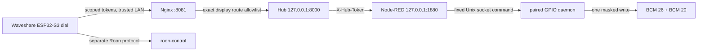

# System architecture

This document describes the recorded Pi 1.3.1 `weather_assisted` installation
and the separately labeled, unimplemented lighting design. For dated proof
of what has been observed, use [PROJECT_STATE.md](PROJECT_STATE.md). Source code,
deployed processes, GPIO levels and physical valve position are separate facts.

## Active control path

The Waveshare dial switches between valve and Roon pages locally. The Roon path
is implemented in the separate
[`roon-knob`](https://github.com/danikeuc/roon-knob) and
[`roon-control`](https://github.com/danikeuc/roon-control) repositories. It has
no authority over the Pi relay daemon.

## Component ownership

| Component | Owns | Interface and exposure | Failure behavior |
| --- | --- | --- | --- |
| Waveshare dial | User interaction and displayed Hub status | Status/history reads and authenticated revision-bound actions through trusted-LAN Nginx | Shows unavailable/unknown and disables valve action when status is unavailable |
| Nginx | LAN gateway allowlist | Port `8081`; seven exact display paths, including scoped weather settings/history | Rejects every other route; the Hub and Node-RED remain loopback-only |
| Hub | Operating mode, 60-600-second manual timing, weather policy, audit/history state | FastAPI on `127.0.0.1:8000`; separate admin/display/Node-RED tokens | Requests `DRAIN` on startup, expiry and command failure |
| Node-RED | Authenticated translation to the fixed GPIO client | One loopback `POST` route; no policy timer and no individual GPIO nodes | Rejects invalid token/command and reports failures to the Hub |
| Paired GPIO daemon | Sole writer of GPIO26/20 and paired readback | Root-controlled Unix socket under `/run/freeze-protect` | Starts at high/high and expires an unrenewed `SUPPLY` lease within 60 seconds |
| Relays and valves | Electrical and hydraulic movement | BCM 26 and 20 drive separate active-low relay inputs | Physical result requires direct observation or position feedback |

## Operating modes

| Mode | Idle state | Can start `SUPPLY` | Inputs that can start it |
| --- | --- | --- | --- |
| `safe_drain` | `SAFE_DRAIN` | No | None |
| `manual_timed` | `MANUAL_DRAIN` | Yes, selected 60-600 seconds (default 600) | One authenticated deliberate display action |
| `weather_assisted` | `USER_OFF` or manual idle/DRAIN | Yes, weather AUTO or bounded manual fallback | Deliberate START, durable inhibition rules and fresh five-day eligibility |
| `automatic` | `FROST_PROTECTION` until sensor/forecast gates pass | Yes | Commissioned healthy PT100/MAX31865 and eligible seven-day forecast |

The recorded installation uses `weather_assisted`, with USER_OFF/DRAIN after
the 1.3.1 installer. Five local daily minima at least 5 C can permit AUTO after
a deliberate START; STOP persists across restarts. Missing/cold/stale forecast
uses bounded manual fallback. PT100 is informational in this mode.
The separate `manual_timed` mode ignores weather for control. Legacy `automatic`
remains a separately commissioned configuration. See
[weather policy](operations/weather-assisted-shower.md) for the exact contract.

Pi 1.3.1 adds a paired-v2 DRAIN readiness gate before Hub startup: retry only
refused connections within a 60-second acceptance window, with a 75-second
systemd outer startup limit. This retains the Hub startup DRAIN and fault latch.
The actual installed systemd change is additive; package and checkout identities
are separately recorded in [installation evidence](evidence/2026-10-11-shower-history-install.md).

## Display temperature telemetry

The authenticated display status includes only `pipe_temperature_c` and
`sensor_health` for temperature. The numeric value is present only when the
reading is healthy and fresh; otherwise it is JSON `null`. Health is reported
as `HEALTHY`, `STALE`, `INVALID`, or `CALIBRATION_REQUIRED`. Non-automatic
modes use `TemperatureTelemetrySampler` at a five-second cadence. Automatic
mode uses `ControlService.last_reading`; the sampler is absent in that mode, so
the temperature source has one reader at a time. A reading at least 15 seconds
old is `STALE`, and a failed sample clears the numeric value rather than
reusing an earlier reading. MAX31865 diagnostics remain administrator-only.

This display telemetry has no control authority. In `manual_timed`, temperature
does not start, extend, stop, or authorize `SUPPLY`; showing a reading does not
set `sensor_commissioned`. Automatic-policy use still requires its separate
sensor commissioning.

## Paired output contract

| Logical command | BCM 26 | BCM 20 | Intended plumbing path |
| --- | ---: | ---: | --- |
| `DRAIN` (`0` in the dial UI) | high | high | `Tuš` to `Izpust` |
| `SUPPLY` (`1` in the dial UI) | low | low | `Dovod` to `Tuš` |

Mixed levels are illegal. A command receipt and `pinctrl` readback establish the
software output state only. They do not establish relay contact state, valve
movement or the plumbing path.

## Trust and secret boundaries

- Admin, display and Node-RED tokens are independent and stored outside Git.
- The dial stores separate display and restricted weather/history credentials;
  the PIN-protected browser admin proxy does not expose them to JavaScript.
- The restricted `freezeprotect-commission` SSH identity exposes four fixed
  commands and no shell, forwarding, GPIO group or environment access.
- Node-RED is bound to loopback. Its exported flow is versioned here, while the
  deployed active flow and runtime versions remain separate evidence.
- Port `8081` is for a trusted local network and must not be forwarded to the
  internet.

## Active and historical sources

The active dial firmware does not live in this repository. Current display
commissioning is in
[`deployment/DISPLAY_COMMISSIONING.md`](../deployment/DISPLAY_COMMISSIONING.md).
The source under `firmware/crowpanel` and
[`deployment/CROWPANEL_COMMISSIONING.md`](../deployment/CROWPANEL_COMMISSIONING.md)
is retained as historical/rollback material and is not provisioned with the
active display token.

## Required failure validation

The implementation has explicit responses for communication loss, Hub
crash/hang, controller restart and power loss/restoration. Test coverage is not
physical proof. The current proof level and remaining deployed/physical checks
are maintained in [PROJECT_STATE.md](PROJECT_STATE.md).

## Independent lighting software - not installed

The [2026-10-12 lighting specification](superpowers/specs/2026-10-12-independent-lighting-design.md)
records the accepted product behavior: independent third relay, camera and Dial
ON in AUTO, and temporary manual ON/OFF with a one-hour default return and M
reminder across pages. The owner confirmed a five-minute hold after the last distinct detection;
admin can configure it. Implementation is authorized and tracked in the
[software plan](superpowers/plans/2026-10-13-independent-lighting.md).

The light controller and GPIO21 executor run separately from the shower
Hub and GPIO26/20 owner. Node-RED adapts UniFi events only; it does not own mode,
timers or light GPIO. Lighting routes/credentials are separate and not present
in the installed seven-path gateway. Roon/Synology need no lighting changes.
The shared Pi/Node-RED runtime still creates common failure domains.

Board/load suitability, actual Protect POST/auth/retry profile and executor
crash/power behavior remain explicit prerequisites. See the specification for
legal output combinations, fault outcomes, UI arbitration and acceptance scope.

The Python lighting implementation is under `src/freeze_protect/lighting/`.
It uses its own SQLite database and an explicitly provisioned revision watermark.
The GPIO executor accepts only line 21, owns a three-second ON lease and rejects
stale generation/fence/lease identities. Fake-I/O tests establish this software
behavior; executor hangs and board power transitions still need bench evidence.
Normal service startup does not recreate a missing database or restore ON.
