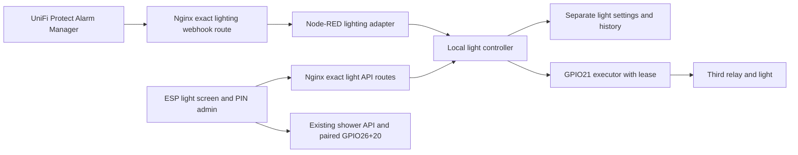

# Independent light: UniFi webhook and ESP Dial

Date: 2026-10-12; implementation authorized 2026-10-13. Status: approved product
contract, with software implementation tracked in the
[implementation plan](../plans/2026-10-13-independent-lighting.md).
**Not installed or physically tested.**
This is the canonical lighting contract. It does not change a released artifact.

## 1. Intent and decisions

The owner wants the third relay to control one light independently of the two
shower valves. UniFi Protect detections and the existing Waveshare Dial can turn
it on. A normal Dial action in AUTO must not disable camera automation. An
explicit manual override must be conspicuous and automatically end, so the
camera is not silently disabled indefinitely.

| Item | Status / decision |
| --- | --- |
| Third relay independent of shower | Owner confirmed |
| Lighting load | Owner reports LED lighting, maximum 20 W total, 220 V mains (2026-10-12); not an electrical measurement |
| Camera and ESP can both turn on light in AUTO | Owner confirmed |
| Explicit manual ON and manual OFF suspend camera control | Accepted interaction proposal |
| Manual warning, M badge on other pages, return-to-AUTO control | Accepted interaction proposal |
| Automatic return to AUTO after one hour; configurable in admin | Accepted interaction proposal; default 3600 seconds |
| Detection hold time | Owner confirmed 300 seconds (5 minutes) after the last distinct accepted detection; configurable in admin |
| Dial timed-ON duration in AUTO | Same configurable hold time as camera; implementation ruling recorded in plan |
| Manual duration range | Implementation range: whole minutes from 1 to 120; default 60 |
| Night-only schedule | Optional later extension; outside first implementation |
| Light history | Separate history with source and mode; never mix with shower transitions |

The manual warning refers to the light only. Shower weather AUTO and light AUTO
are different state machines; neither changes the other.

## 2. Evidence and hardware boundary

Current Pi 1.3.1 and Dial v1.3.0-shower.3 installation evidence is in
[the installation record](../../evidence/2026-10-11-shower-history-install.md).
Existing paired daemon source owns only PINS=(26,20). The September board record
identifies Waveshare RPi Relay Board relay 3 as BCM21 / header40, active-low.
This is documented pin provenance, not a fresh hardware/revision observation.

| Output | Documented pin | Intended owner | Electrical meaning |
| --- | --- | --- | --- |
| Shower relays 1+2 | BCM26/header37 + BCM20/header38 | Existing paired daemon | high/high DRAIN, low/low SUPPLY |
| Light relay 3 | BCM21/header40, confirm actual board/jumpers | New light GPIO executor only | Proposed low=energized, high=released, verify board |

Keep the paired daemon's pin set and protocol unchanged. Legal logical states
(V1,V2,light), where 1 means energized, are (0,0,0), (0,0,1), (1,1,0), (1,1,1).
Mixed valve states remain forbidden. Light operations must never request, reset,
release, or globally clean up GPIO26/20. A failure of light control must not send
shower commands. Shared Pi power/CPU/network remain common failure domains;
independent control is not redundant hardware.

The owner specifies LED lighting, maximum 20 W total at 220 V mains.
Before wiring or any energized test, verify the supply against the actual lamp/driver
label and identify board revision/jumpers, light/driver model, nominal and inrush
current, contact rating for that load,
NO/NC wiring and protective enclosure. Determine whether the relay switches the
load directly or a suitably rated contactor/control input. For mains wiring use
a qualified electrician. No mains wiring diagram or load suitability is claimed
by this design. OFF is proposed for ordinary convenience lighting; confirm that
this is not emergency/escape lighting before treating OFF as the safe outcome.

## 3. Recommended architecture and alternatives

Recommended: separate light controller process with durable settings/history,
a separate GPIO21 executor with a bounded lease, and Node-RED only as an ingress
adapter for UniFi. Existing shower Hub/daemon stay independent. A lighting-only
process restart does not restart the shower services. Node-RED remains shared;
a Node-RED crash can still interrupt its existing shower bridge.

Alternatives considered: putting all timers/GPIO in a Node-RED Function node
would couple policy and expiry to that event loop; adding light policy to the
shower controller would couple state/storage failures. Neither is selected.

One controller owns mode, deadlines, deduplication and revisions. One executor
owns the light GPIO. Node-RED and Dial submit intent, never write pins or invent
expiry. Transport roles must have separate light-scoped credentials; no shower,
Roon or administrative credential may authorize a camera event.

## 4. State and arbitration

Modes: AUTO, MANUAL_ON, MANUAL_OFF. Separately report desired ON/OFF, confirmed
GPIO state, health, cause and remaining time. FAULT/UNAVAILABLE are health states,
not evidence of physical OFF. Automatic return runs on the Pi, not in the UI.

| Current mode / input | Result |
| --- | --- |
| AUTO + distinct fresh camera detection | ON; extend camera hold deadline |
| AUTO + Dial timed ON | ON; extend Dial hold deadline, remain AUTO |
| AUTO + Dial immediate OFF | Clear both holds and request OFF, remain AUTO; a later new camera event may turn on again |
| Any mode + explicit manual ON | MANUAL_ON, ON, start manual deadline |
| Any mode + explicit manual OFF | MANUAL_OFF, OFF, start manual deadline |
| Manual mode + camera event | Acknowledge ignored; record dedup identity, no output or timer change, no queue |
| Manual mode + normal ON/OFF gesture | Explicit new manual command; UI shows new return deadline before confirmation |
| Manual deadline expires or user selects Back to AUTO | Clear manual and old AUTO holds, request OFF, mode AUTO; require a new detection/gesture for ON |
| Same request ID / event redelivered | Return recorded outcome; do not extend any deadline |
| Settings save / UI refresh / history read | Never energize or reset active deadlines |
| Controller restart | Clear pending ON holds; request/confirm OFF before accepting events; recover mode as below |

In AUTO use separate camera and Dial deadlines; ON while either unexpired hold
exists. A new source deadline cannot shorten the other. Serial processing and a
control revision resolve concurrent UI/events. An explicit mode change clears
previous holds and advances the event-admission boundary. Events captured before
that boundary cannot turn on the light after returning to AUTO. A repeated
manual request with the same ID never resets its return timer.

Use monotonic time while running. Persist mode, configuration, manual expiry
UTC and event dedup state. After restart, never restore MANUAL_ON as energized:
recover it as MANUAL_OFF for the remaining valid override and show interruption.
A still-valid MANUAL_OFF stays inhibited until its original deadline. An expired
manual override returns AUTO/OFF. If persisted expiry or wall clock is unreliable,
hold OFF with a visible recovery fault and require an explicit Back to AUTO;
do not silently leave the camera disabled. Fault recovery is separate from timer
expiry. A fresh event is required after healthy recovery.

Manual-mode duration changes apply to the next explicit override. Reconnect,
page navigation, repeated polling and local display countdown do not extend it.

## 5. Dial and admin UX contract

- Add a third main page, Luč, with a minimal bulb icon,
  current confirmed state, AUTO/manual label and relevant countdown.
- AUTO: ordinary tap sends timed ON when off or immediate OFF when on, without
  changing mode. Explain that a later detection can turn it on again.
- Manual controls must be explicit; an ordinary AUTO tap cannot enter manual.
- Manual card: **ROČNO — kamera začasno izključena**,
  plus **AUTO čez 42 min**. Show **Nazaj na AUTO** as a direct action.
- Persist a small bulb + M reminder on shower and Roon pages during either
  manual state; do not steal their volume, playlist, swipe or shower gestures.
- Reminder derives from confirmed Pi state. When stale, show unknown/offline;
  never remove M or show AUTO merely because the local countdown reached zero.
- No light commands from the QGSQ BLE remote in the first version. Existing media
  mappings and shared playlists remain unchanged.
- PIN-protected admin gets a light section: hold duration, manual return duration,
  confirmed mode/expiry, webhook configuration status and bounded light history.
- Do not reveal webhook/control secrets to browser JavaScript or raw event logs.
- Feature hidden/disabled on old Pi capability; no fallback to a shower endpoint.

## 6. Protocol and UniFi profile

The software API uses the following routes. Exact strict schemas, role-specific
credentials, bounds and revision domains are in the
[implementation plan](../plans/2026-10-13-independent-lighting.md) and contract
tests. These routes have not been enabled on the installed gateway.

| Method and path | Caller / meaning |
| --- | --- |
| POST /api/v1/lights/events/unifi | Protect via exact Nginx/Node-RED route; camera event only |
| GET /api/v1/lights/status | Dial; mode, state, health, revision, deadlines, last cause |
| POST /api/v1/lights/actions | Dial; timed_on, off, manual_on, manual_off, auto |
| GET/PUT /api/v1/lights/settings | PIN admin proxy; revision-checked settings |
| GET /api/v1/lights/history | PIN admin proxy; bounded read-only event projection |

UI mutations carry an action, unique request ID and expected controller revision;
unknown/stale revisions conflict and require a fresh deliberate decision. Reads
are side-effect free. ON is not reported confirmed until a matching executor
receipt is verified. Timeout is an uncertain outcome; reread state rather than
silently retrying with a new ID. OFF remains available through a fresh request
when there is uncertainty.

UniFi Protect officially supports outgoing custom webhooks; GET is the default,
POST supplies alarm data and timestamp. Select POST. The documented sample has
no guaranteed unique event ID or end-of-motion event. Capture a redacted sample
from the actual Protect version, including retry behavior and authentication
options, before freezing the adapter. Use alarm/camera IDs when supplied, never
assume display names are unique. If no stable ID exists, review a canonical
fingerprint of source/alarm/type/original timestamp and document collision limits.
Do not manufacture a new UUID at every delivery and call that deduplication.

Prefer a dedicated authentication header plus allowed sender network, method,
body-size/rate bounds and fresh event timestamps. Official docs explicitly
mention custom headers for GET, not guaranteed support for every POST version:
verify authenticated POST on this console. If unavailable, review an authenticated
local adapter or compatible profile before live activation; no token-in-URL,
unauthenticated endpoint or GET actuation fallback. Reject missing identity/time
rather than accepting an event without the agreed replay protection.

Settings/history live separately from the shower SQLite state. A lighting storage
failure requests light OFF and reports a light fault; it must not fault the
shower. Keep bounded dedup records through restarts for the accepted replay
window. Limit/rate overflow rejects new events rather than evicting still-valid
identities and accidentally extending ON. Save compact source/reason/deadline
history, not full camera payloads, private URLs, images or credentials.

## 7. Fault outcomes and remaining proof

All outcomes below are requirements, not successful physical tests. The exact
light GPIO backend, lease and supervisor budgets are not yet measured; choose
and test those bounds before enabling real loads. A process timer does not
survive that process hanging.

| Fault domain | Required outcome | Surviving enforcement / time boundary | Evidence still required |
| --- | --- | --- | --- |
| Camera, LAN or Dial link lost | Existing AUTO holds expire; manual override returns at its deadline; no stale replay | Local controller and executor; configured hold/manual deadlines | Offline expiry and reconnect trace |
| Node-RED crash/hang/redeploy | No new camera actions; existing deadlines remain; Dial path still usable | Separate light controller/executor; configured deadlines | Adapter failure test; existing shared shower bridge impact recorded |
| Light controller crash/hang | Light OFF on executor lease expiry | Separate executor; software maximum lease 3 seconds, physical cutoff unmeasured | Kill and stalled controller tests |
| Light executor crash/hang | Reach OFF without relying on its cleanup | Supervisor/hardware release behavior must be established; maximum response unknown | Backend line release, supervisor and hardware evidence; live gate remains open |
| Pi reset/reboot | No ON pulse; startup OFF; no restore of old ON intent | Board bias/boot behavior before software, then executor readiness | Pre-application capture, reset timing and mode recovery |
| Pi supply lost/restored while relay supply remains | No unintended ON during floating/control loss | Board input bias/isolation; wiring-dependent, response time unknown | Actual power-domain test with load disconnected |
| Relay-board supply lost/restored | Released contact and no unexpected ON on restoration | Coil/contact wiring and passive behavior, time unknown | Contact/bias verification |
| Light supply lost/restored with controller alive | Do not promise dark-on-return: an active command may relight the load | Supply-loss sensing is not specified | Identify whether this behavior is acceptable or requires feedback/interlock |

Legal output combinations remain those in section 2 through every tested trace.
No claim that GPIO readback proves lamp illumination. Live acceptance later needs
an observer, identified isolation method, bounded duration/cutoff and a verified
stop mechanism surviving the injected fault. None is authorized by this document.

## 8. Acceptance matrix and prerequisites

Implementation must exercise the real policy with fake clocks/transports, then
bench hardware separately. Required cases: simultaneous camera + Dial holds;
new vs duplicate camera events; manual ON/OFF blocking camera; one-hour default
return to AUTO; no replay of ignored events; ordinary AUTO tap preserving mode;
mode change races; wall-clock jump/reboot during manual override; stale UI badges;
settings save not extending deadlines; history reads causing zero writes; every
fault row above; zero GPIO26/20 touches from the lighting subsystem.

Before commissioning or enabling real inputs, resolve:

1. Verify the actual lamp/driver label against the reported 220 V / maximum 20 W
   total LED load; identify model/inrush, board revision, contact wiring and role
   of the light (ordinary versus safety lighting).
2. Actual Protect version and sanitized POST/auth/retry/event identity sample.
3. Exact Node-RED/Node.js versions, relevant palette, Projects status and active
   flow/settings paths; repository flow is not runtime inventory.
4. Verify the selected libgpiod line-21 backend, OFF-before-ownership behavior,
   executor crash protection and measured lease/supervisor response bounds.
   Fake-I/O tests of the three-second software lease do not close this gate.

The owner subsequently authorized software implementation on 2026-10-13.
Fake-clock, fake-I/O, adapter, native UI and browser checks can proceed while
these evidence gaps remain open. They prevent claiming wiring readiness or
deployment approval. Flow deployment, GPIO access and firmware upload require
a separate commissioning step.

## 9. Source map and review

- [Node-RED adapter contract](../../operations/independent-lighting-node-red.md)
- [Current architecture](../../ARCHITECTURE.md)
- [Evidence reconciliation](../../evidence/2026-10-12-lighting-documentation-reconciliation.md)
- Dial UI integration: companion repository docs/operations/independent-lighting.md.
- Roon bridge requires no new routes or credentials for this feature.
- Historical GPIO21 reservation remains correct for prior milestones. This spec
  proposes its future reassignment only; it does not rewrite historical evidence.

Primary sources checked 2026-10-12:
[UniFi outgoing webhooks](https://help.ui.com/hc/en-us/articles/25478744592023-Send-UniFi-Protect-Alerts-to-Web-Services-using-Webhooks),
[Node-RED security](https://nodered.org/docs/user-guide/runtime/securing-node-red).
Board pin provenance: repository 2026-09-11 M1 weather/display specification;
manufacturer page could not be fetched during this review, so current board
verification remains a commissioning prerequisite.
